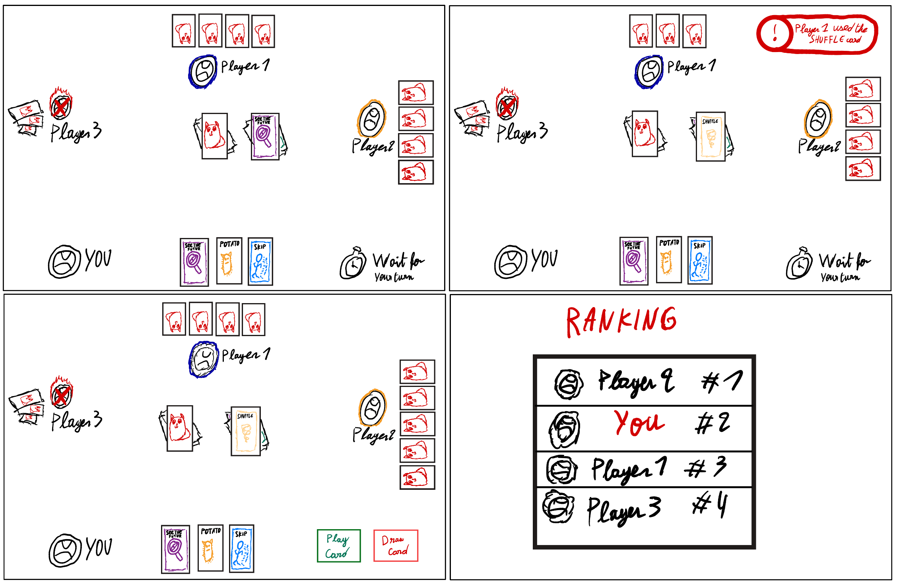

# ul2025app9

## How To Start

### Initialisation

Launch the server from the root of the project:

```bash
$ sbt --client
```

Inside the sbt shell, start the webapp:

```bash
$ run
```

Open `localhost:8080` inside your favourite browser, select the ul2025app9 app, add 2 to 4 players to the game, and join as yourself.
The game will already be launched by this time, and you will be able to share the join code to your friends.

### Playing the Game

This game is a recreation of Exploding Kittens, the rulebook of which can be found [here](https://cdn.shopify.com/s/files/1/0345/9180/1483/files/ekoe-instructions-english.pdf?v=1743802429). The basic rules are as follow:

- Every player takes turn drawing cards. If you draw a bomb card, you explode and you're out of the game. The last player alive wins. The rest of the cards are there to help you avoid exploding first.
- When it is your turn, you may play any number of cards from your hand (including not playing anything). You end your turn by drawing a card.
- If you draw a bomb, you must show it to the table, and use a defuse card if you have one. In this case, you may insert the bomb back into the draw secretly in any position. If you cannot defuse, you explode and the next player is up.
- Other cards play as follows:
    - Attack: end your turn immediately without drawing a card, the next player must play two turns. An attack played on top of another attack adds the turns for the next player.
    - Favour: pick a player. They must give you a card of their choice.
    - Nope: cancel any action other than a bomb or defuse. This can be played at any time by any player, and can also be cancelled by another Nope card.
    - Shuffle: shuffle the deck randomly.
    - Skip: end your turn immediately without drawing a card.
    - Forecast: secretly see the next three cards from the draw pile.
    - Match: when played as a pair, you may pick a player and steal a random card from them.

## Proposal

### User stories

- As a player, I want to play cards from my hand and draw cards from the draw pile using my mouse during my turn, so that I can easily and intuitively take my actions.
- As a player, I want the effects of the card I play to be applied correctly and to be able to interact with other players when required, so that the game rules are fully respected.
- As a player, I want to see what other players are doing during their turns and how many cards they have, so that I can understand the game state and plan my strategy.
- As a player, after the game ends, I want to see who won and the order in which players were eliminated, so that I clearly understand the final outcome of the game.


### Requirements

- Players take turns in a clockwise order.
- During their turn, a player may play any number of cards from their hand, and must then end their turn either by playing an attack or skip card, or by drawing a card from the deck.
- If a player draws a bomb card and does not have a defuser card, the player is immediately eliminated from the game.
- When a bomb card is drawn, a defuser card allows the player to place the bomb back into the deck at a position of their choice.
- Playing an attack card immediately ends the current player’s turn and forces the next player to take two turns, requiring them to draw twice unless they play cards to avoid drawing.
- Playing a skip card allows a player to end their turn without drawing a card.
- Other cards provide additional interactions:
- favour allows a player to request a card from another player,
- forecast allows a player to see the next three cards in the draw pile,
- shuffle randomizes the order of the draw pile,
- nope allows a player to cancel the effect of another card.
- The game displays the list of players who are still active.
- Each player can see how many cards each opponent currently has.
- The game continues until only one player remains active.
- At the end of the game, a scoreboard is displayed showing the winner and the order in which players were eliminated.

### Roles

- Game logic : Arthur
- Front-end : Adam & Saad
- Back-end : Arthur
- Testing : Adam & Saad
- Integration : Arthur
- UI : Adam & Saad

### Mock-ups


